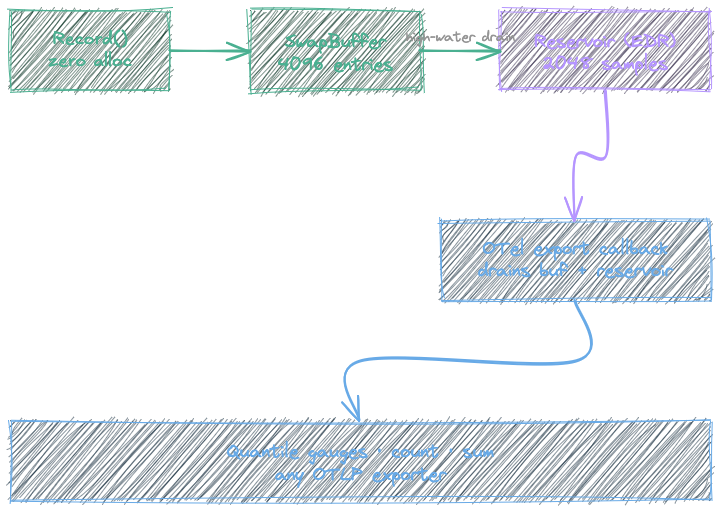

# Nanov.OpenTelemetry.Summary

[](https://www.nuget.org/packages/Nanov.OpenTelemetry.Summary)
[](https://www.nuget.org/packages/Nanov.OpenTelemetry.Summary)
[](https://github.com/nanov/Nanov.OpenTelemetry.Summary/actions/workflows/ci.yml)
[](https://opensource.org/licenses/MIT)

A Summary metric for OpenTelemetry .NET. Computes quantiles (p95, p99, etc.) client-side and reports them as gauges through the standard OTLP pipeline.

## Why

OpenTelemetry .NET doesn't have a Summary metric type. The built-in Histogram works, but each bucket boundary generates a separate time series. With 15 buckets across many pods and short export intervals, that gets expensive fast on backends like Coralogix.

This library computes quantiles inside your app and emits them as simple gauges. Fewer series, same insight.

## Install

Targets .NET 9, .NET 10 and .NET 11.

```bash
dotnet add package Nanov.OpenTelemetry.Summary
```

## Quick start

```csharp
using System.Diagnostics.Metrics;
using Nanov.OpenTelemetry.Summary;

var meter = new Meter("MyApp");
var summary = meter.CreateSummary("http.request.duration", unit: "ms");

// Record a value
summary.Record(42.5);

// Record with tags
summary.Record(42.5, new TagList {
    { "endpoint", "/api/users" },
    { "method", "GET" }
});
```

That's it. The summary registers observable gauges on the meter, so any configured OTel exporter picks them up automatically.

Tags are compared as a set, so `{a, b}` and `{b, a}` are the same series. Every tag set is kept for the life of the summary, so keep their cardinality low: route templates, not ids.

## Choosing how to record

Each tag set is its own series. Recording with tags first has to find that series: it hashes every tag key and value, then looks the set up in a dictionary. That lookup is most of the cost of a tagged `Record`. A bound handle does it once, when you create it.

| Call | Cost (.NET 11, M4 Pro) | Use when |
|---|---|---|
| `summary.Record(value)` | ~4 ns | No tags. |
| `handle.Record(value)` from `summary.Bind(tags)` | ~5 ns | The tags are known ahead of time: a fixed route, a queue name, an operation. Bind once (at startup, or once per route) and keep the handle. |
| `summary.Record(value, tags)` | ~40 ns with 3 tags, more with more tags | The tags are only known per call, such as a status code or an outcome. |

```csharp
// Known ahead of time: bind once, record many times.
var getUser = summary.Bind(new TagList { { "endpoint", "/api/users" }, { "method", "GET" } });

getUser.Record(12.0);

using (getUser.Time()) {
    await ProcessRequest();
}

// Known only per call: pass the tags each time.
summary.Record(elapsed, new TagList { { "endpoint", "/api/users" }, { "status", statusCode } });
```

A handle is a small struct; copies record into the same series. Don't call `Bind` per call, because that pays the lookup every time and gains nothing over `Record(value, tags)`. Neither form allocates, except that the first value of a new tag set creates its series once.

None of the three forms waits on a lock, and the lookup runs on the recording thread, so the cost does not grow with the number of threads recording at once. The ASP.NET Core and HttpClient bridges below get new tags with every request, so they use the per-call form.

## What gets reported

By default, each summary emits:

| Metric | Type | Description |
|---|---|---|
| `{name}` | Gauge | Quantile values, tagged with `quantile="0.95"`, `quantile="0.99"` |
| `{name}.count` | Counter | Total number of observations (monotonic) |
| `{name}.sum` | Counter | Sum of all observed values |

Max is available as an opt-in:

| Metric | Type | Description |
|---|---|---|
| `{name}.max` | Gauge | Largest value recorded in the window |

And one more appears only when it is non-zero:

| Metric | Type | Description |
|---|---|---|
| `{name}.dropped` | Counter | Values recorded but left out of the quantiles' sample (monotonic) |

Quantiles and max cover the values recorded since the previous export. A tag set with no values in a window reports no quantile or max point. Count and sum keep growing. Count, sum and max include dropped values; only the quantiles miss them. If `.dropped` grows, raise `WithBufferCapacity`.

Quantile labels are written with two decimals in the invariant culture (`0.95`, `0.50`), except where two decimals would round: `0.999` stays `0.999` instead of `1.00`. NaN values are ignored.

## Configuration

```csharp
var summary = meter.CreateSummary("http.request.duration", "ms",
    description: "HTTP request latency",
    configure: options => options
        .WithQuantiles(0.50, 0.95, 0.99)   // default: 0.95, 0.99
        .WithMax()                          // opt-in
        .WithoutSum()                       // disable sum counter
        .WithoutCount()                     // disable count counter
        .WithBufferCapacity(8192)           // default: 4096, per tag set
        .WithReservoir(sampleSize: 2048, alpha: 0.015));
```

## Timing operations

Two patterns, depending on whether you know the tags upfront.

When tags are known ahead of time, use `using`:

```csharp
using (summary.Time(new TagList { { "endpoint", "/api/users" } }))
{
    await ProcessRequest();
}
```

When tags depend on the outcome (success/failure, status code), use the manual pattern:

```csharp
var timer = summary.Time();
try
{
    await ProcessRequest();
    timer.Record(new TagList { { "status", "success" } });
}
catch
{
    timer.Record(new TagList { { "status", "failure" } });
    throw;
}
```

Don't combine the two: a timer in a `using` block that also calls `Record(tags)` records twice.

The timer looks up its starting tags when it starts, so disposing it costs the same as a handle's `Record`. For a series you time often, `summary.Bind(tags).Time()` on a handle you keep skips that lookup at start too.

`Duration()` is an alias for `Time()` if you prefer that naming.

## OTel pipeline setup

Works with any OTel exporter. Just register the meter:

```csharp
builder.Services.AddOpenTelemetry()
    .WithMetrics(metrics => metrics
        .AddMeter("MyApp")
        .AddOtlpExporter());
```

## ASP.NET Core & HttpClient instrumentation

Companion packages turn the built-in .NET HTTP duration histograms into
summaries — you get p95/p99 gauges instead of paying for histogram buckets, with
a drop-in API that mirrors the OpenTelemetry contrib instrumentation. Install
only the one(s) you need:

```bash
dotnet add package Nanov.OpenTelemetry.Summary.Instrumentation.AspNetCore
dotnet add package Nanov.OpenTelemetry.Summary.Instrumentation.Http
```

```csharp
builder.Services.AddOpenTelemetry()
    .WithMetrics(metrics => metrics
        .AddSummaryAspNetCoreInstrumentation()
        .AddSummaryHttpClientInstrumentation(o => o.WithQuantiles(0.5, 0.95, 0.99))
        .AddOtlpExporter());
```

Both build on a shared `Nanov.OpenTelemetry.Summary.Instrumentation` package that
exposes the generic primitive `AddSummaryBridge(meterName, instrumentName, ...)`
for bridging any other histogram into a summary.

They attach a `MeterListener` to `http.server.request.duration` /
`http.client.request.duration` and forwards every measurement into a `Summary`
emitted under the **same name** (distinguished by the `quantile` tag). Because
the source meter is never registered with the `MeterProvider`, the original
histogram is observed but never aggregated into buckets or exported — only the
summary gauges are.

Don't call `AddAspNetCoreInstrumentation()` / `AddHttpClientInstrumentation()`
alongside these unless you deliberately want both the histogram and the summary.

## Grafana / Coralogix dashboards

### Latency overview (p95 & p99)

```promql
# p99 by endpoint, worst pod in the fleet
max by (endpoint) (http_request_duration_ms{quantile="0.99"})

# p95 by endpoint
max by (endpoint) (http_request_duration_ms{quantile="0.95"})
```

Use these as two time series on a single panel. Set the Y-axis unit to milliseconds. This gives you the tail latency per endpoint across all pods.

### Request rate

```promql
sum by (endpoint) (rate(http_request_duration_ms_count[5m]))
```

Shows requests per second per endpoint. Good as a stacked area chart to see traffic distribution.

### Average latency

```promql
sum by (endpoint) (rate(http_request_duration_ms_sum[5m]))
/
sum by (endpoint) (rate(http_request_duration_ms_count[5m]))
```

Average latency per endpoint. Useful alongside percentiles to spot whether the tail is an outlier or a systemic shift.

### SLO alerting

```promql
# Alert when p99 exceeds 500ms for 5 minutes
max by (service) (http_request_duration_ms{quantile="0.99"}) > 500
```

In Coralogix, create an alert with this query and a `for: 5m` duration. Use `max by (service)` to catch the worst pod — if any single pod breaches the SLO, you want to know.

### Suggested dashboard layout

1. **Top row**: p95 and p99 latency (line chart), request rate (stacked area)
2. **Middle row**: average latency (line chart), error rate from a separate counter if available
3. **Bottom row**: per-endpoint breakdown tables or heatmaps

Filter everything by `service` and `endpoint` variables at the top of the dashboard.

## How it works

`Record` finds the tag set's series with a lock-free lookup that hashes the caller's tags in place, then stores the value in that series' buffer with one atomic add. The buffer is split into stripes, one per core, and each thread writes to its own, so cores do not contend. A stripe's memory is allocated by the first value it receives, so a rarely used tag set stays small.

When a stripe is three-quarters full, the series queues itself on the thread pool, which moves the buffered values into an exponentially decaying reservoir (EDR). The reservoir holds up to 1028 samples by default, biased toward recent values, and grows to that size only as values arrive.

At export, the quantile gauge's callback drains what is left, computes weighted quantiles from the reservoir and starts a new window. The other instruments report from that same window.

A value that finds both halves of its stripe full is left out of the sample but still counted in `.count`, `.sum` and `.max`, and `.dropped` says how many there were. Neither path locks or allocates, except that a new tag set allocates its series once.



## Performance

Apple M4 Pro, BenchmarkDotNet short job, a `MeterListener` subscribed so the summary is enabled. Nothing below allocates.

| Operation | .NET 9 | .NET 11 |
|---|---|---|
| `Record`, no tags | 5.7 ns | 4.2 ns |
| `Record`, 3 tags | 44 ns | 41 ns |
| Bound handle `Record` | 5.9 ns | 4.6 ns |
| 4 threads × 10,000 records | 158 µs | 145 µs |
| 8 threads × 10,000 records | 216 µs | 302 µs |
| Reservoir: 1,000 records + snapshot | 55 µs | 59 µs |

Against the previous release on .NET 9, measured the same way: the concurrent runs dropped from 985 µs and 2,561 µs, and the reservoir from 185 µs. A tagged `Record` cost about 4 ns before because it only copied the tags into a shared buffer and left the lookup to a single aggregation thread. In a loop like this one, that thread fell behind and most values were discarded without being counted. Now the lookup runs on the caller's thread; see [Choosing how to record](#choosing-how-to-record).

Tight loops record faster than the thread pool drains, so part of each figure is the cost of values that overflowed into `.dropped`.

Comparisons with prometheus-net and AppMetrics are in [`benchmarks/.../RESULTS.MD`](benchmarks/Nanov.OpenTelemetry.Summary.Benchmarks/RESULTS.MD). Run them with:

```bash
cd benchmarks/Nanov.OpenTelemetry.Summary.Benchmarks
dotnet run -c Release -f net9.0 -- --filter '*'
dotnet run -c Release -f net11.0 -- --filter '*' --inProcess   # BenchmarkDotNet 0.15 does not recognize .NET 11 as a separate runtime yet
```

## License

MIT
